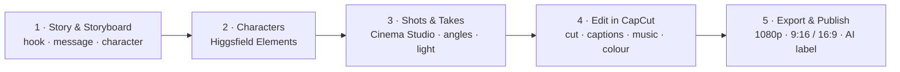

# Creating Engaging Videos with Generative AI (GenAI)

Hook, story and storyboard first, shoot it in Higgsfield, finish it in CapCut: one engaging video from idea to export.

| Course detail | Information |
|---|---|
| Course code | `TGS-2024043855` |
| Programme | WSQ |
| Duration | 2 days / 16 hours (including a 2-hour assessment) |
| Registration | [View course details and register](https://www.tertiarycourses.com.sg/wsq-creating-engaging-videos-with-generative-ai-genai.html) |
| Funding | Up to 70% course-fee funding may be available (funding validity 2 Apr 2024 – 1 Apr 2027). Eligibility and terms apply; check the registration page for current details. |
| Courseware version | v12 · 23 November 2026 |

## About the course

Topic 1 opens with two videos cut from the same footage, one you stop watching and one you watch to the end, and asks what makes a video engaging: **hooks, one message, characters and storytelling**. You then plan your own video on a storyboard, shoot it in [Higgsfield](https://higgsfield.ai) with cinematic technique (shot sizes, camera angles and movement, light, lens, colour), and finish it in [CapCut](https://www.capcut.com): cut it to time, add captions, music and a call to action, fix what fails and export to platform spec. Topic 3 ends with the ethics of GenAI video: copyright and IP, consent, bias, deepfakes and disclosure.

## Learning outcomes

- **LO1** — Create video scripts using Generative AI (GAI) and work plans for video production.
- **LO2** — Edit video footage to improve video quality and ensure technical compliance.
- **LO3** — Apply new AI technologies to improve efficiency and quality in accordance to industry standards.

Skills Framework: TSC *Video Editing* (`MED-MPN-4005-1.1`).

## Topics covered

- **Topic 1 — Create and Edit Video Script Using Generative AI (GAI):** what makes a video engaging, hooks for the first three seconds, one message, characters, a 15-second story in five beats, scripts and storyboards with GenAI, house rules and a work plan.
- **Topic 2 — Improve Video Footage on GAI Powered Video Platforms:** shot sizes, camera angles and movement, light, lens, colour and cinematic effects, the Higgsfield UI, prompts for characters and prompts that follow the storyboard, Draft takes and quality checks.
- **Topic 3 — Apply new AI technologies to Improve Video Production:** post-production in CapCut, what to cut when a video runs long, captions, music and colour, AI tools that fix and finish (remove objects, VFX, voice, music, enhance audio), remedial actions, export standards and ethics.

## Activities

Three activities build one video. Every prompt is on one copy page: [labs/prompts.html](labs/prompts.html). Each folder holds `README.pdf` (step-by-step instructions), `prompts.html` (one-click copy prompts), `prompts.pdf` and `assets/` (templates and samples). Start from the [activities home page](labs/index.html).

1. [Hook, Story and Storyboard: Plan Your 15-Second Video](labs/lab-01-hook-story-and-storyboard-plan-your-15-second-vi/) (Topic 1)
2. [Shoot It in Higgsfield: Characters, Cinematic Shots and Takes](labs/lab-02-shoot-it-in-higgsfield-characters-cinematic-shot/) (Topic 2)
3. [Finish It in CapCut: Cut, Polish and Export the Final Video](labs/lab-03-finish-it-in-capcut-cut-polish-and-export-the-fi/) (Topic 3)

## What you need

- A laptop with Chrome and a headset, and [CapCut desktop](https://www.capcut.com) (free download; some tools are marked Pro).
- A Higgsfield account for Activity 2. Sign up with the course link [higgsfield.ai?fpr=alfred-d0d32b](https://higgsfield.ai?fpr=alfred-d0d32b): this is the trainer's affiliate link; the trainer may earn a commission and you pay the normal price. The website needs a paid plan (Plus was US$49/month, or US$39 billed yearly, for 1,000 credits on 8 Nov 2026).
- No paid plan? [VidoGrid](https://vidogrid.ai) is free to start for 480p test takes (observed 23 Nov 2026).
- Budget guide: a 15-second Seedance 2.5 Draft costs about 45 credits; the 1080p final about 240.

## Public courseware package

| Item | Files |
|---|---|
| Slide deck (v12) | [PPTX](<courseware/Creating Engaging Videos with Generative AI (GenAI)-v12.pptx>) · [PDF](<courseware/Creating Engaging Videos with Generative AI (GenAI)-v12.pdf>) |
| Learner Guide | [DOCX](<courseware/LG-Creating Engaging Videos with Generative AI (GenAI).docx>) · [PDF](<courseware/LG-Creating Engaging Videos with Generative AI (GenAI).pdf>) · [Markdown](<LG-Creating Engaging Videos with Generative AI (GenAI).md>) |
| Lesson Plan | [DOCX](<courseware/LP-Creating Engaging Videos with Generative AI (GenAI).docx>) · [PDF](<courseware/LP-Creating Engaging Videos with Generative AI (GenAI).pdf>) |
| Videos | [Video A, boring (20 s)](<courseware/assets/videos/t1-boring-20s.mp4>) · [Video B, engaging (18 s)](<courseware/assets/videos/t1-engaging-18s.mp4>) · [SOLA ad (15 s)](<courseware/assets/videos/marketing-sola-15s-h264.mp4>) · [Ringfall (15 s)](<courseware/assets/videos/scifi-ring-15s-h264.mp4>) |
| Activities | [`labs/`](labs/) — 3 hands-on activities · [all prompts](labs/prompts.html) |

In PowerPoint Slide Show, click a video to play it: all four videos are embedded and play offline.

## Distribution boundary

This public repository intentionally excludes the assessments and answer keys, the Facilitator Guide and Assessment Plan, source references, credentials and `.env` files. Those are distributed only through the controlled courseware and TMS channels.

## Provider

Developed and delivered by [Tertiary Infotech Academy Pte Ltd](https://www.tertiarycourses.com.sg) (UEN 201200696W) · enquiry@tertiaryinfotech.com · +65 6100 0613.
