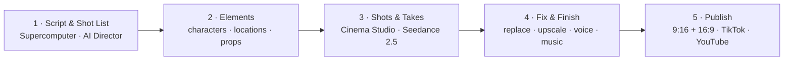

# Creating Engaging Videos with Generative AI (GenAI)

Script, cast, shoot, fix and publish a 15-second film in one AI studio: Higgsfield.

| Course detail | Information |
|---|---|
| Course code | `TGS-2024043855` |
| Programme | WSQ |
| Duration | 2 days / 16 hours (including a 2-hour assessment) |
| Registration | [View course details and register](https://www.tertiarycourses.com.sg/wsq-creating-engaging-videos-with-generative-ai-genai.html) |
| Funding | Up to 70% course-fee funding may be available (funding validity 2 Apr 2024 – 1 Apr 2027). Eligibility and terms apply; check the registration page for current details. |
| Courseware version | v9 · 9 November 2026 |

## About the course

The whole GenAI video pipeline runs inside [Higgsfield](https://higgsfield.ai): you brief **Supercomputer**, Higgsfield's agent, in plain English, or direct every shot yourself in **Cinema Studio**. You write a script and shot list with AI Director, save your cast, sets and props as reusable **Elements**, direct takes with **Seedance 2.5** (testing on cheap 480p **Draft** takes before a 1080p final), fix what fails, add voice, music and cinematic effects, and publish a labelled 15-second ad.

Topic 1 opens with two 15-second films made in Higgsfield for this course and real-world use cases: AI movies, AI micro dramas, AI influencers, AI singers and AI marketing videos. Topic 3 ends with a mini capstone, where you direct your own 15-second video, and the core ethical issues of GenAI video with real lawsuits and rulings.

## Learning outcomes

- **LO1** — Create video scripts using Generative AI (GAI) and work plans for video production.
- **LO2** — Edit video footage to improve video quality and ensure technical compliance.
- **LO3** — Apply new AI technologies to improve efficiency and quality in accordance to industry standards.

Skills Framework: TSC *Video Editing* (`MED-MPN-4005-1.1`).

## Topics covered

- **Topic 1 — Create and Edit Video Script Using Generative AI (GenAI):** the impact of AI on video creation and its use cases, Supercomputer and AI Director scripts and shot lists, Skills, standards and guidelines, work plans and credit budgets.
- **Topic 2 — Improve Video Footage on GenAI-Powered Video Platforms:** Elements (characters, locations, props), references, Cinema Studio controls, shot structure and sizes, sound, Draft mode and takes, assessing the cut.
- **Topic 3 — Apply New AI Technologies to Improve Video Production:** remedial actions (replace objects, upscale, reframe, regenerate a shot), voice, music and cinematic effects, comparing models, industry standards and AI disclosure, publishing, a mini capstone and the core ethical issues of GenAI video.

## Labs

Ten labs, all in Higgsfield; Lab 10 is a mini capstone. Every prompt is on one copy page: [labs/prompts.html](labs/prompts.html). Each folder holds `README.pdf` (step-by-step instructions), `prompts.html` (one-click copy prompts), `prompts.pdf` and `assets/` (mock briefs, templates, checklists and sample media). Start from the [labs home page](labs/index.html).

**Topic 1**

1. [Sign Up and Make Your First 15-Second Video](labs/lab-01-sign-up-and-make-your-first-15-second-video/)
2. [Write the Script and Shot List with Supercomputer and AI Director](labs/lab-02-write-the-script-and-shot-list-with-supercompute/)
3. [Set the House Rules: Standards, Work Plan and Credit Budget](labs/lab-03-set-the-house-rules-standards-work-plan-and-cred/)

**Topic 2**

4. [Build Your Elements: Characters, Locations and Props](labs/lab-04-build-your-elements-characters-locations-and-pro/)
5. [Direct Shots and Takes in Cinema Studio](labs/lab-05-direct-shots-and-takes-in-cinema-studio/)
6. [Cut, Caption and Assess the Scene](labs/lab-06-cut-caption-and-assess-the-scene/)

**Topic 3**

7. [Fix What Fails: Remedial Actions in Higgsfield](labs/lab-07-fix-what-fails-remedial-actions-in-higgsfield/)
8. [Add Voice, Music and Cinematic Effects](labs/lab-08-add-voice-music-and-cinematic-effects/)
9. [Use-Case Sprint: One Product Photo to a Published 15-Second Ad](labs/lab-09-use-case-sprint-one-product-photo-to-a-published/)
10. [Mini Capstone: Direct Your Own 15-Second Video in Higgsfield](labs/lab-10-mini-capstone-direct-your-own-15-second-video-in/)

## What you need

- A laptop with Chrome and a headset.
- A Higgsfield account on a paid plan. Sign up with the course link [higgsfield.ai?fpr=alfred-d0d32b](https://higgsfield.ai?fpr=alfred-d0d32b) — this is the trainer's affiliate link: the trainer may earn a commission and you pay the normal price. The labs run on higgsfield.ai, which needs a paid plan (Plus was US$49/month, or US$39 billed yearly, for 1,000 credits on 8 Nov 2026). The free 3-day trial needs a card, renews to Plus unless cancelled within 3 days, and its credits worked only through the Higgsfield MCP, not on the website.
- Budget guide: a 15-second Seedance 2.5 Draft costs about 45 credits; the 1080p final about 240.
- Reference: [Higgsfield API docs](https://docs.higgsfield.ai/docs) · [Supercomputer and Skills](https://higgsfield.ai/supercomputer-intro).

## Public courseware package

| Item | Files |
|---|---|
| Slide deck (v9) | [PPTX](<courseware/Creating Engaging Videos with Generative AI (GenAI)-v9.pptx>) · [PDF](<courseware/Creating Engaging Videos with Generative AI (GenAI)-v9.pdf>) |
| Learner Guide | [DOCX](<courseware/LG-Creating Engaging Videos with Generative AI (GenAI).docx>) · [PDF](<courseware/LG-Creating Engaging Videos with Generative AI (GenAI).pdf>) · [Markdown](<LG-Creating Engaging Videos with Generative AI (GenAI).md>) |
| Lesson Plan | [DOCX](<courseware/LP-Creating Engaging Videos with Generative AI (GenAI).docx>) · [PDF](<courseware/LP-Creating Engaging Videos with Generative AI (GenAI).pdf>) |
| Demo films | [SOLA product ad (15 s)](<courseware/assets/videos/marketing-sola-15s-h264.mp4>) · [Ringfall sci-fi scene (15 s)](<courseware/assets/videos/scifi-ring-15s-h264.mp4>) |
| Labs | [`labs/`](labs/) — 10 hands-on labs · [all prompts](labs/prompts.html) |

In PowerPoint Slide Show, click a video to play it: the two demo films are embedded; the YouTube examples need internet and **Enable Content** on the yellow security bar first.

## Distribution boundary

This public repository intentionally excludes the assessments and answer keys, the Facilitator Guide and Assessment Plan, source references, credentials and `.env` files. Those are distributed only through the controlled courseware and TMS channels.

## Provider

Developed and delivered by [Tertiary Infotech Academy Pte Ltd](https://www.tertiarycourses.com.sg) (UEN 201200696W) · enquiry@tertiaryinfotech.com · +65 6100 0613.
