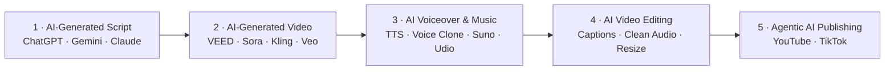

# Creating Engaging Videos with Generative AI (GenAI)

**WSQ Course Code:** TGS-2024043855 · **Tertiary Infotech Academy Pte Ltd** (UEN 201200696W)

Courseware for the 2-day WSQ course that takes you from a text prompt to a published video — with generative AI at every stage of the production pipeline.

📄 Course page: [WSQ - Creating Engaging Videos with Generative AI (GenAI)](https://www.tertiarycourses.com.sg/wsq-creating-engaging-videos-with-generative-ai-genai.html)

## The GenAI Video Creation Pipeline

Every lab in this course maps to a stage of this pipeline.

## What's in this repo

| Folder / file | Contents |
|---|---|
| `courseware/` | Slide deck (PPT v7 + PDF), Lesson Plan (LP), Learner Guide (LG) |
| `labs/` | 12 hands-on labs — **one folder per lab**, each with prompts, step-by-step and a success check |
| `LG-*.md` | Markdown mirror of the Learner Guide |

## Topics & labs

**Topic 1 — Create and Edit Video Script Using GenAI**
1. Generate a Video Script with the RICCE Framework
2. Build Story-Driven Scripts with Prompt Templates & Custom GPTs
3. AI Text-to-Video with VEED
4. Develop Video Standards, Guidelines & a Production Work Plan

**Topic 2 — Improve Video Footage on GenAI-Powered Video Platforms**
5. VEED Video Editing Essentials
6. Auto Subtitles, Captions, Transcripts & Translation
7. AI Voiceover, Clean Audio & Background Removal
8. Mini Project — Assess and Fix Video Quality

**Topic 3 — Apply New AI Technologies to Improve Video Production**
9. AI Avatars, AI Images & Eye Contact
10. AI Music Generation with Suno & Udio
11. Voice Cloning, AI Dubbing & Lip Sync
12. Agentic AI Publishing to YouTube & TikTok

## Tools used

[VEED](https://www.veed.io/) (AI Video Maker, editor, subtitles, TTS, avatars, dubbing) · ChatGPT / Gemini / Claude / Copilot · Suno · Udio · ElevenLabs · YouTube Studio · TikTok

## Learning outcomes

- **LO1** — Develop video editing strategies and work plans to achieve creative video.
- **LO2** — Assess edited video footage to enhance storytelling and ensure technical compliance.
- **LO3** — Develop remedial actions to ensure industry compliance and facilitate the adoption of new technologies in video editing.

---

© 2026 Tertiary Infotech Academy Pte Ltd · [tertiarycourses.com.sg](https://www.tertiarycourses.com.sg) · enquiry@tertiaryinfotech.com · +65 6100 0613
