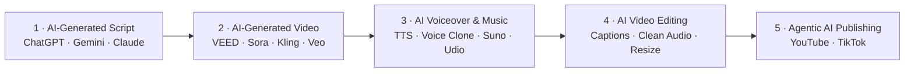

# Creating Engaging Videos with Generative AI (GenAI)

Take a video from text prompt to published post, with generative AI at every stage of the production pipeline.

| Course detail | Information |
|---|---|
| Course code | `TGS-2024043855` |
| Programme | WSQ |
| Duration | 2 days / 16 hours |
| Registration | [View course details and register](https://www.tertiarycourses.com.sg/wsq-creating-engaging-videos-with-generative-ai-genai.html) |
| Funding | Up to 70% course-fee funding may be available. Eligibility, validity dates and other terms apply; check the registration page for current details. |

## About the course

This 2-day WSQ course walks learners through an AI-assisted video production pipeline: writing scripts with generative AI, producing text-to-video footage, adding AI voiceover and music, editing on VEED, and publishing with agentic AI to YouTube and TikTok.

Every lab in this course maps to a stage of this pipeline.

## Learning outcomes

- **LO1** — Develop video editing strategies and work plans to achieve creative video.
- **LO2** — Assess edited video footage to enhance storytelling and ensure technical compliance.
- **LO3** — Develop remedial actions to ensure industry compliance and facilitate the adoption of new technologies in video editing.

## Topics covered

- **Topic 1 — Create and Edit Video Script Using GenAI**
- **Topic 2 — Improve Video Footage on GenAI-Powered Video Platforms**
- **Topic 3 — Apply New AI Technologies to Improve Video Production**

Tools used: [VEED](https://www.veed.io/) (AI Video Maker, editor, subtitles, TTS, avatars, dubbing) · ChatGPT / Gemini / Claude / Copilot · Suno · Udio · ElevenLabs · YouTube Studio · TikTok

## Labs

One folder per lab, each with prompts, step-by-step instructions and a success check. See the [labs index](labs/README.md).

**Topic 1 — Create and Edit Video Script Using GenAI**

1. [Generate a Video Script with the RICCE Framework](labs/lab-01-generate-a-video-script-with-the-ricce-framework/)
2. [Build Story-Driven Scripts with Prompt Templates & Custom GPTs](labs/lab-02-build-story-driven-scripts-with-prompt-templates/)
3. [AI Text-to-Video with VEED](labs/lab-03-ai-text-to-video-with-veed/)
4. [Develop Video Standards, Guidelines & a Production Work Plan](labs/lab-04-develop-video-standards-guidelines-a-production/)

**Topic 2 — Improve Video Footage on GenAI-Powered Video Platforms**

5. [VEED Video Editing Essentials](labs/lab-05-veed-video-editing-essentials/)
6. [Auto Subtitles, Captions, Transcripts & Translation](labs/lab-06-auto-subtitles-captions-transcripts-translation/)
7. [AI Voiceover, Clean Audio & Background Removal](labs/lab-07-ai-voiceover-clean-audio-background-removal/)
8. [Mini Project — Assess and Fix Video Quality](labs/lab-08-mini-project-assess-and-fix-video-quality/)

**Topic 3 — Apply New AI Technologies to Improve Video Production**

9. [AI Avatars, AI Images & Eye Contact](labs/lab-09-ai-avatars-ai-images-eye-contact/)
10. [AI Music Generation with Suno & Udio](labs/lab-10-ai-music-generation-with-suno-udio/)
11. [Voice Cloning, AI Dubbing & Lip Sync](labs/lab-11-voice-cloning-ai-dubbing-lip-sync/)
12. [Agentic AI Publishing to YouTube & TikTok](labs/lab-12-agentic-ai-publishing-to-youtube-tiktok/)

## Public courseware package

| Item | Files |
|---|---|
| Slide deck (v7) | [PPTX](<courseware/Creating Engaging Videos with Generative AI (GenAI)-v7.pptx>) · [PDF](<courseware/Creating Engaging Videos with Generative AI (GenAI)-v7.pdf>) |
| Learner Guide | [DOCX](<courseware/LG-Creating Engaging Videos with Generative AI (GenAI).docx>) · [PDF](<courseware/LG-Creating Engaging Videos with Generative AI (GenAI).pdf>) · [Markdown](<LG-Creating Engaging Videos with Generative AI (GenAI).md>) |
| Lesson Plan | [DOCX](<courseware/LP-Creating Engaging Videos with Generative AI (GenAI).docx>) · [PDF](<courseware/LP-Creating Engaging Videos with Generative AI (GenAI).pdf>) |
| Labs | [`labs/`](labs/) — 12 hands-on labs |

## Distribution boundary

This public repository intentionally excludes assessments, answer keys, source references, credentials and `.env` files. Assessments are distributed only through the controlled courseware and TMS channels.

## Provider

Conducted by Tertiary Infotech Academy Pte Ltd (UEN 201200696W) · [tertiarycourses.com.sg](https://www.tertiarycourses.com.sg) · enquiry@tertiaryinfotech.com · +65 6100 0613

© 2026 Tertiary Infotech Academy Pte Ltd. All rights reserved.
